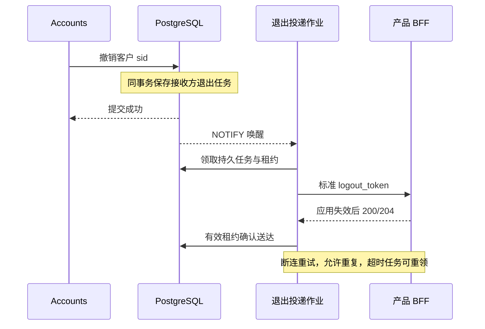

# Session 管理设计

## 当前中央会话与 RP 会话

> 2026-11-24：客户中央会话可靠退出第一单元已本地实现，未部署。当前入口为 OIDC `/oidc/*`；下文历史 token-cookie / source 接入流程仅保留迁移参考，不能用于新产品接入。

- Accounts 中央会话以 sid 标识；客户 durable authority 为 `session.auth_sessions`，Redis 为交互状态。缺失、撤销或到期的持久记录不能继续授权；读取故障返回不可用，不把故障解释成退出。
- `finishTenantLogin` 先持久创建，再写 Redis，成功后才返回中央 cookie / 授权码。两层共用绝对到期时间，补偿失败也不能变成登录成功。
- 产品 BFF 自建 HttpOnly 本地 RP 会话并保管 token；浏览器通过自己的 BFF 获取视图。中央 cookie 清除本身不会删除别的产品会话。
- 授权码发布前写 `oidc_session_clients`；客户撤销/自然到期在同一事务写入 `logout_deliveries`。标准 OIDC 后台退出可重试，按 sid 幂等处理；发送成功与所有页面刷新是不同阶段。
- 客户当前组织/空间由成员关系验证后，作为一对持久保存，变化时增加 context_version；没有持久上下文的旧记录允许读旧 Redis 上下文过渡。切换不延长会话寿命，权限不从事件载荷授予。
- workforce 继续独立会话与授权检查，本批不把客户表当作员工事实源。



当前仍有既有页面同步与按需中央状态查询。SSE、丢事件快照恢复、产品持久 inbox 完成并验收后，才按客户端退役身份轮询。服务端后台补扫未完成任务保留。

接口状态见 [150-event-sync-api.md](./150-event-sync-api.md)，部署和恢复见[运行手册](../../60-operations/50-run-identity-events.md)，实施记录见[批次计划](../../70-workplan/110-identity-center-batches.md)。

## 历史 token-cookie 机制（迁移参考）

### 核心约定

- JWT 由 **auth-bff 独家签发**，任何其他 BFF 禁止自行生成 Token
- Access Token（短周期）+ Refresh Token（长周期）双 Token 机制
- Token 通过 **HttpOnly Cookie** 传输，前端不能读取，防 XSS
- Ruyin 是外部业务仓 `vxture/agentstudio-ruyin` 维护的接入方；本文只定义平台 SSO / Cookie 契约，不定义 Ruyin 本地实现或 vx-worker-02 部署。

---

## Cookie 命名规范

| Cookie 名称               | 域            | 用途                   |
| ------------------------- | ------------- | ---------------------- |
| `vx_tenant_access_token`  | `.vxture.com` | 租户用户 Access Token  |
| `vx_tenant_refresh_token` | `.vxture.com` | 租户用户 Refresh Token |
| `ry_access_token`         | `.ruyin.ai`   | Ruyin 域 Access Token  |
| `ry_refresh_token`        | `.ruyin.ai`   | Ruyin 域 Refresh Token |

`vx_tenant_*` 同时用于 website 和 console，两个门户共享同一套 Cookie（同域）。

常量定义：`packages/shared/shared/src/constants/auth.constants.ts` → `TENANT_COOKIE_KEYS` / `RUYIN_COOKIE_KEYS`

---

## LoginSource 与 Token 类型

```typescript
type LoginSource = "website" | "console" | "admin" | "ruyin";
```

| LoginSource | Token 类型    | Cookie 域     |
| ----------- | ------------- | ------------- |
| `website`   | `tenant_user` | `.vxture.com` |
| `console`   | `tenant_user` | `.vxture.com` |
| `admin`     | `operator`    | `.vxture.com` |
| `ruyin`     | `tenant_user` | `.ruyin.ai`   |

代码入口：`bff/auth-bff/src/auth/auth.service.ts`

---

## Redis 存储结构

`bff/auth-bff/src/redis/redis.service.ts` 使用以下键模式（含可配置前缀）：

| 键模式                                     | 用途                              | TTL                 |
| ------------------------------------------ | --------------------------------- | ------------------- |
| `{prefix}refresh:tenant:platform:{userId}` | 租户 Refresh Token（.vxture.com） | Refresh TTL         |
| `{prefix}refresh:tenant:ruyin:{userId}`    | 租户 Refresh Token（ruyin.ai）    | Refresh TTL         |
| `{prefix}refresh:operator:{userId}`        | 运营 Refresh Token                | Refresh TTL         |
| `{prefix}blacklist:{jti}`                  | 已吊销 Access Token（jti 索引）   | Access TTL 剩余时长 |
| `{prefix}crossdomain:{token}`              | 跨域一次性令牌                    | 30s                 |
| `{prefix}oauth:state:{state}`              | OAuth CSRF 防重放 state           | 10min               |

---

## Token 续期流程

```
浏览器携带 Refresh Token Cookie
  ↓
POST /api/auth/refresh → auth-bff
  ↓
1. 验证 Refresh Token 签名
2. 查 Redis 确认 refresh 键存在（防重放）
3. 签发新 Access Token
4. 可选：滚动续期（rotating refresh）
  ↓
Set-Cookie: 新 Access Token（HttpOnly）
```

---

## 登出与 Token 吊销

```
POST /api/auth/logout
  ↓
1. 读取当前 Access Token jti
2. Redis SET blacklist:{jti}（TTL = Token 剩余有效期）
3. Redis DEL refresh:tenant:platform:{userId}（或对应类型）
4. 清除所有 Cookie（Set-Cookie: expires=past）
```

单设备登出只删该 userId 对应的 refresh 键；多设备全退出需按 userId 前缀批量删除。

---

## 跨域 SSO（Vxture Console ↔ 业务应用）

不同根域之间无法共享 Cookie，通过**Console SSO start endpoint + 一次性令牌中转**实现。同域应用也使用同一协议，便于后续新增业务应用时保持入口一致。

### 调用协议

业务应用跳转到 Console 的 SSO start endpoint，并通过既有跨 Portal `ctx` 参数传递来源上下文：

```text
GET https://console.vxture.com/{locale}/sso/start?ctx=<urlencoded-json>
```

`ctx` 使用 `PortalNavContext` 结构：

```json
{
  "from": "ruyin",
  "returnTo": "https://vpn.ruyin.ai/auth/callback",
  "caller": "Ruyin",
  "state": "optional-random-state"
}
```

字段约定：

| 字段       | 必填 | 说明                                                          |
| ---------- | ---- | ------------------------------------------------------------- |
| `from`     | 是   | 来源应用标识，用于 Console 侧做 `returnTo` origin 白名单校验  |
| `returnTo` | 是   | 业务应用 SSO callback 绝对 URL                                |
| `caller`   | 是   | 来源应用展示名，用于 Console 顶栏/返回入口                    |
| `state`    | 否   | 业务应用生成的随机值，Vxture 原样带回，用于防 CSRF 或恢复状态 |

`ctx.from` 是安全策略标识，必须命中 Vxture 侧白名单；`ctx.caller` 是展示名称，可由业务应用按品牌传入。`ctx` 参数必须使用 `URLSearchParams` 写入，避免手写 JSON 转义。

### 流程

```
1. 用户在业务应用点击「使用 Vxture 登录」
   ↓
2. 业务应用跳转 Console SSO start endpoint，并携带 ctx
   ↓
3. Console 验证登录态；未登录时先进入 Console 登录页，登录完成后继续 SSO start
   ↓
4. Console 按 ctx.from 校验 ctx.returnTo 的 origin 白名单
   ↓
5. Console 调用 auth-bff 生成 crossdomain token（随机字符串），并传入受白名单保护的 targetDomain
   Redis SET crossdomain:{token} → payload（TTL 30s）
   ↓
6. Console 重定向到 ctx.returnTo，并追加 token 与可选 state
   https://vpn.ruyin.ai/auth/callback?token=...&state=...
   ↓
7. 业务应用 callback 在服务端调用 auth-bff /auth/crossdomain/verify
   Redis GETDEL crossdomain:{token}（原子操作，只能消费一次）
   ↓
8. 业务应用委托 auth-bff /auth/internal/sign 签发本域 Cookie
```

TTL 30s + GETDEL 原子操作确保令牌单次有效，防止重放。

### 安全边界

- Console SSO start endpoint 必须按 `ctx.from` 校验 `ctx.returnTo` 的 origin 白名单，禁止开放重定向。
- auth-bff `GET /auth/crossdomain/token` 必须校验 `targetDomain` 白名单，禁止调用方自行生成任意目标域 token。
- `ctx.returnTo` 必须是绝对 URL，禁止相对路径、`javascript:`、`data:` 等非 HTTP(S) scheme。
- `state` 由业务应用生成并校验，Vxture 只负责原样带回，不解释其内容。
- crossdomain token 不得写入日志，不得进入长期存储，TTL 不得超过 30 秒。
- 业务应用 callback 必须在服务端消费 token，禁止在浏览器端直接调用 `auth-bff` 内部接口。

### 首个应用：Ruyin

`ruyin` 是对 Vxture 暴露的整体应用标识，VPN 等能力属于 ruyin.ai 内部子应用，不拆分为独立 SSO app。首个生产回调地址：

```text
https://vpn.ruyin.ai/auth/callback
```

对应 SSO start endpoint：

```text
https://console.vxture.com/zh-CN/sso/start
```

对应 `ctx.from` 白名单至少包含：

```text
ruyin → https://vpn.ruyin.ai
```

---

## 参考文档

- `docs/30-design/auth.md` — 完整认证体系设计
- `docs/40-implementation/packages/bff/auth.md` — auth-bff 关键约束
- `packages/shared/shared/src/constants/auth.constants.ts` — Cookie 常量定义
