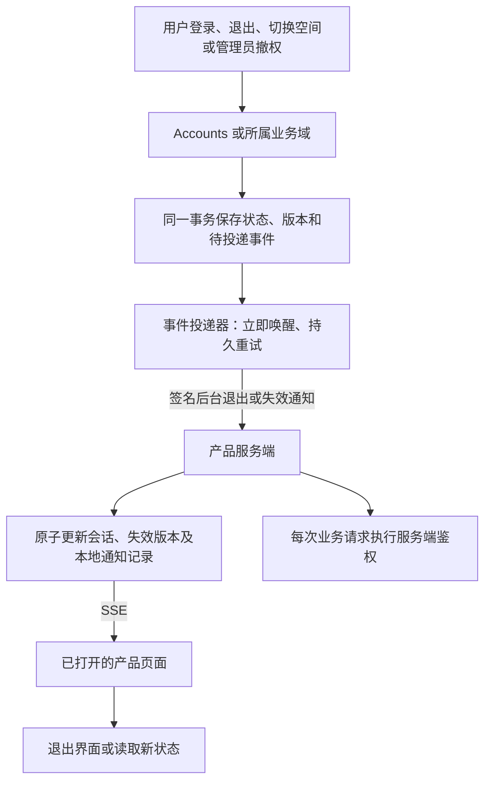

<!--
@package @vxture/repo
@layer Application
@category workplan
@author AI-Generated
@date 2026-11-24
-->

# 跨系统登录、退出与权限同步：技术路线与实施方案

> 日期：2026-11-24（Asia/Shanghai）。状态：C2 RP 修复、C3/C4 可靠退出/恢复、C6 Console 退出 SSE、C5 事实事件与 changes-v1 恢复读取已本地验证；变化投递/接收、完整页面失效、轮询退役、发布及跨产品验收待后续批次。当前状态统一见 [120 进展页](./120-identity-sync-progress.md)。
> 用户已确认的目标：**有变化才通知，页面立即响应，漏消息能够恢复，访问权限始终由服务端确认。**
> 本文记录技术选择、实施顺序和验收条件。跨仓接口的权威仍为[产品接入通则](https://claude.ai/code/artifact/20e37039-ea59-4c5d-9fab-ba3ca3ad54f0)及[产品接入范本](https://claude.ai/code/artifact/f0bd83c7-6296-4200-a7d8-108b7755f584)。本次用户授权新增身份事件协议独立编制，候选定义及产品接收步骤见 [150-event-sync-api.md](../30-design/identity/150-event-sync-api.md)；已有 OIDC / 商业契约不复制。本文继续只记录技术路线。
> 平台中心侧的任务拆分、依赖及接口文档交付清单见 [110-identity-center-batches.md](./110-identity-center-batches.md)；该计划将接口通则与范本定稿设为实现前置条件。

<!-- Executive route -->

## 1. 技术路线：统一身份、可靠事件、页面推送

**Accounts 统一管理中央登录状态；平台在状态变化时可靠通知产品；产品服务端处理失效，再通过 SSE 通知自己的页面。**

| 层次             | 采用技术                                           | 解决的问题                                         |
| ---------------- | -------------------------------------------------- | -------------------------------------------------- |
| 登录与 SSO       | OIDC Authorization Code + PKCE，沿用现有接入       | 一次认证后，各产品通过 Accounts 建立自己的合法会话 |
| 跨产品退出       | 标准 OIDC Back-Channel Logout，补齐持久投递和重试  | 在一个产品退出后，关联产品的服务端会话及时失效     |
| 上下文与授权变化 | 事务事件记录、带版本的失效通知、可信快照恢复       | 工作空间、成员、角色、席位变化能可靠传播           |
| 产品到浏览器     | 同源 BFF 的 SSE 长连接                             | 页面空闲时也能响应真实变化                         |
| 同源多标签页     | BroadcastChannel；连接复用可结合 Web Locks         | 协调同一产品的页面，减少重复连接和重复读取         |
| 业务安全         | 服务端会话检查、当前主体准入检查、产品内部权限检查 | 页面是否收到通知都不能决定业务授权                 |

SSE 适合服务端向页面单向通知，能够复用 HTTP 基建、连接重建及事件游标。现阶段不引入 WebSocket 双向消息协议，也不为这条链路新增 Kafka 集群；优先使用现有 PostgreSQL、Redis 和各产品 BFF。

预期体验：用户在 A 退出，B、C 的空闲页面也退出；切换工作空间后，其他已绑定产品更新到经过验证的新上下文；撤销某产品席位后，该产品停止接受业务操作并更新页面。普通切换标签页不再触发登录状态或权限查询。

## 2. 范围与“取消轮询”的准确含义

本次覆盖登录状态同步、跨产品退出、当前组织 / 工作空间同步，以及影响产品准入的账号、成员、治理角色、席位变化。产品内部角色由产品自己管理，并接入自己的页面通知链。

| 现有或候选行为                               | 目标处理                                                   |
| -------------------------------------------- | ---------------------------------------------------------- |
| 浏览器每隔数秒或数分钟查询 session / 权限    | 事件链验收后取消                                           |
| 每次 focus / visibilitychange 都查询权限     | 取消；仅在连接或快照确实失效时恢复                         |
| 产品后台循环扫描每个用户中央登录状态         | 不作为正常同步机制                                         |
| 首次进入产品读取当前会话                     | 保留，一次建立可信初始状态                                 |
| 收到真实失效事件后读取最新状态               | 保留，按作用域合并并发读取                                 |
| 断线重连、服务重启、游标失效后的恢复         | 保留，先补事件，必要时读取快照                             |
| 实际业务请求的认证与授权                     | 保留；现有逐请求 product-access 不因 SSE 而删除            |
| 按 next_check_at 在实际请求上检查中央状态    | 迁移及故障兜底保留，遵守现行通则；不改为浏览器定时器       |
| SSE 心跳                                     | 保留少量保活流量；不查 C2、不刷新令牌、不报告用户活动      |
| 投递失败重试、到期任务、队列修复检查         | 保留基础设施任务；不按在线用户数循环查状态                 |
| 商业开通 GET /platform/provisioning 定期对账 | 现行通则仍要求，属于另一条生命周期恢复链；本次不能顺带删除 |

因此，“不再轮询”指退出与身份 / 权限同步不再靠页面或产品反复查询事实来发现变化。系统仍有连接维护、真实请求鉴权、失败重试和少量基础设施恢复工作。

## 3. 问题依据与当前边界

### 3.1 Issues

| Issue                                                                 | 已知事实                                                                                         | 本方案对应工作                                      |
| --------------------------------------------------------------------- | ------------------------------------------------------------------------------------------------ | --------------------------------------------------- |
| [#726](https://github.com/vxture-platform/vxture-platform/issues/726) | 2026-11-23 Karda 退出后 Arda 仍登录；反向曾观测成功。确切中央 sid 绑定和 HTTP 投递链尚未建立证据 | 退出关联追踪、可靠投递、身份变更与断线恢复          |
| [#538](https://github.com/vxture-platform/vxture-platform/issues/538) | 中央状态接口已交付；历史方向为实际活动时按需查询，未承诺空闲页推送                               | 保留查询兜底，增加事件主路径，区分身份与令牌        |
| [#731](https://github.com/vxture-platform/vxture-platform/issues/731) | 请求授权 / 撤权的可靠失效事件；产品侧已有本地角色与消息机制                                      | 平台成员 / 席位变化与事件同事务提交；不自动授予席位 |
| [#724](https://github.com/vxture-platform/vxture-platform/issues/724) | 商业生命周期通知、读取与 ACK 的环境隔离待明确                                                    | 身份事件登记与恢复从一开始绑定可信客户端和环境      |

### 3.2 已检查代码

| 位置                                                                                                                                     | 观察                                                                                                  | 影响                                             |
| ---------------------------------------------------------------------------------------------------------------------------------------- | ----------------------------------------------------------------------------------------------------- | ------------------------------------------------ |
| [OidcService](../../bff/auth-bff/src/oidc/oidc.service.ts) 的 endSession / sendBackChannelLogouts                                        | 普通退出先删除 Redis 会话及客户端索引，再尽力投递；默认路径不检查非 2xx，也没有显式请求超时和持久重试 | 网络故障、进程退出或接收方异常可能造成永久漏通知 |
| [RedisService](../../bff/auth-bff/src/redis/redis.service.ts) 的 addOidcSessionClient                                                    | 绑定登记失败被记录但不阻止授权流程继续                                                                | 可能存在已授权却不在退出接收名单中的 RP          |
| [RpSessionStore](../../packages/core/oidc-rp/src/rp-session.store.ts) 的 update                                                          | 通过 create 重写记录，没有撤销屏障或条件更新                                                          | 并发刷新可以写回已删除会话                       |
| [RpAuthService](../../packages/core/oidc-rp/src/rp-auth.service.ts) 的 doRefresh                                                         | 异常后若回读不到更晚令牌，就删除 RP 会话                                                              | 网络故障会被转换成退出                           |
| [ConsoleSessionProvider](../../portals/console/src/features/session/ConsoleSessionProvider.tsx) 及其他门户会话组件                       | 多处 300 秒轮询、focus / visibility 查询；Console BroadcastChannel 只覆盖同源                         | 空闲页面收敛慢，重复查询多                       |
| [工作空间上下文写入](../../bff/auth-bff/src/redis/redis.service.ts)                                                                      | 当前工作区已有原子写入，但缺少对应可靠版本事件                                                        | 旧产品令牌与缓存不能仅凭 status 查询感知切换     |
| [ProductSeatRepository](../../services/commerce/subscription/src/repository/pg-product-seat.repository.ts) 及已检查调用链                | 席位撤销更新数据库，未见配套可靠事件提交                                                              | 空闲产品无法及时感知撤权                         |
| [Workbench 会话存储](../../bff/workbench-bff/src/auth/session-store.ts)与[认证服务](../../bff/workbench-bff/src/auth/session-service.ts) | 已有 Lua 条件更新、撤销标记、分布式锁和故障区分                                                       | 可复用设计经验，不能跨 BFF 包直接引用实现        |

前期用现有 RpSessionStore / RpAuthService 和纯内存 Redis 替身复现了两项行为：刷新在后台退出之后完成会重新建立会话；模拟刷新网络异常会删除本地会话。该证据验证的是类级行为，不是生产故障定位或完整 Redis 集成验收。

当前工作区还有未提交的上下文同步等改动；实施前应确定基线及归属，避免覆盖其他任务。文档和本地代码均不等同生产已部署。

<!-- Authority and consistency -->

## 4. 状态归属与一致性原则

### 4.1 谁拥有事实

| 事实                                   | 权威方                         | 产品保存什么                               |
| -------------------------------------- | ------------------------------ | ------------------------------------------ |
| 中央登录是否有效、何时到期、何时撤销   | Accounts                       | 经验证的绑定、有限期状态检查结果与撤销标记 |
| 同一中央会话当前组织 / 工作空间        | Accounts，选择须经成员关系验证 | 当前受控取票得到的上下文及版本             |
| 平台成员状态、治理角色、席位、商业准入 | 对应平台业务域                 | 允许的短缓存、失效版本、必要的主体引用     |
| 产品内部角色                           | 对应产品                       | 产品自己的角色数据和权限版本               |
| 页面当前展示                           | 产品前端                       | 服务端快照及已应用版本，不作为授权依据     |

事件用于撤销或提示旧状态失效。一般身份 / 权限变化不能凭事件载荷直接授予新权限，须重新读取权威事实。标准且有效的后台退出通知可以直接撤销其绑定会话。

### 4.2 采用 PostgreSQL 事务事件记录

推荐以 PostgreSQL 作为客户中央会话生命周期、共享上下文版本和可靠事件的持久依据。Redis 保存运行缓存、锁及实时分发数据，失去 Redis 缓存不能重新授权已撤销会话。

当前客户会话已有 session.auth_sessions，但共享上下文仍主要在 Redis；第一实施批应将需要可靠传播的上下文及其版本纳入持久事务边界。以下内容一起提交：

1. 会话撤销或上下文 / 授权事实变更。
2. 对应作用域的单调版本前进。
3. 待投递事件，以及能恢复接收方的持久关联记录。

不采用“先提交业务数据，再异步写事件”的双写方式。Redis 删除、实时唤醒与 HTTP 发送发生在持久提交之后，失败可重放。客户会话查询、authorize、refresh 等入口应统一遵守持久撤销及账号有效性判据，不能只在一条入口查数据库、另一条入口信任旧缓存。

运营 workforce 使用独立的状态与作用域；不能复用 customer 表的身份语义来实现运营退出。其持久状态与事件原子边界在运营迁移批明确，完成前不撤其兜底机制。

### 4.3 从授权建立时确保退出可追踪

RP 与中央会话的绑定需要可靠保存。新授权结果可供兑换前，应保证该客户端已经进入可恢复的接收方集合；不能继续允许“绑定失败但授权成功”。绑定与退出并发时，双方按同一会话锁 / 版本规则串行化，授权提交前复查会话有效性。

接收方关联至少能区分中央会话、realm、OIDC client 与登记的运行环境。事件对应的目标集合必须在中央会话缓存删除后仍可恢复。受众由已验证绑定和业务授权推导，浏览器不能用自报 workspace 扩大订阅范围。

### 4.4 明确立即生效与最终送达的边界

中央撤销持久提交后，Accounts 的新授权和刷新即拒绝该会话；产品应用撤销后，后续请求即拒绝该本地会话。跨产品投递存在实际延迟，网络分区下不能承诺所有远端同时改变。

仅验证尚未过期 JWT 的签名不足以立即感知撤销。产品还须检查自己的服务端会话和撤销版本，并保留现行按需中央状态检查；席位等准入继续通过实时 product-access 判定。无法确认必要资格时，相关业务操作拒绝或返回可恢复故障，不继续使用无限期旧授权。

事件机制主要降低状态传播延迟和重复查询量，不取代每次业务请求的安全门。高风险动作的权威核验与既有 step-up 继续执行。

## 5. 可靠投递设计

### 5.1 立即唤醒、持久重试

平台事务内写事件，可用 PostgreSQL NOTIFY 在提交后唤醒投递器；投递器用租约和 SKIP LOCKED 领取任务。通知只是唤醒信号，持久事件表才决定还有哪些工作待完成。

投递器启动、数据库监听重连时先补读积压。失败任务按 next-attempt 时间安排唤醒，使用有上限的退避及抖动。可保留低频队列修复检查，防监听或调度漏唤醒；检查的是待处理事件，不是逐用户轮询 session。

每个接收方独立记录发送、响应、重试和失败状态，一个产品故障不能阻塞用户退出或其他产品投递。超过自动重试策略进入可见的失败队列，提供告警和受控重放；不能把“停止重试”当成“处理成功”。

### 5.2 退出与其他失效事件

退出沿用现有 OIDC 后台退出端点和 logout_token 验签语义。补齐 HTTP 超时、状态检查、目标地址安全校验及投递追踪；不自动跟随重定向把签名载荷交给未登记接收方。

重试可能超过当前 logout_token 的 120 秒寿命，因此持久保存逻辑撤销事实，发送时按既定 OIDC 规则生成有效签名。逻辑事件 / 投递去重标识与每次短期签名封套的关系须在通则原件明确，不能无限重发已过期 JWT，也不能通过延长令牌寿命掩盖重试问题。

组织 / 工作空间、成员、角色、席位变化需要带版本的失效通知。推荐复用现有签名 Webhook 登记及投递能力，补齐身份类事件受众与环境隔离；当前 C3 不能直接被假定已支持这些新事件。也不把上下文变化伪装成 OIDC logout，以免无必要地结束中央登录。

现有投递引擎的租约、重试、签名能力可以复用；身份事件需独立优先级和容量预算，不排在大量商业事件后等待。共享传输实现可在基础设施层抽取，身份和授权语义仍由所属域决定。

### 5.3 产品接收与确认

产品验证签名、发行方、受众、时效、环境及作用域后，原子完成接收记录、失效标记 / 版本更新和本地待通知记录，再返回成功。需要耗时重读的工作可在可靠入队后执行，期间相关上下文保持待核验状态。

禁止先回成功再仅写内存队列。重复投递应幂等；确认响应丢失后，平台重投不会造成重复副作用。接收方不能将前端首页的 HTTP 200 当成有效回执，端点验收要包含真实签名请求与处理证据。

### 5.4 版本、乱序与恢复

按作用域维护单调版本；用户会话、工作区成员资格、产品席位是不同作用域，不能共用一个无边界序号。事件 ID 用于去重，版本用于避免旧事件覆盖新状态，流游标用于恢复传输；三者不互相替代。

收到重复或较旧版本不回退；发现缺口或无法解释的版本时，标记对应缓存失效并读取可信快照。重新授权后的新会话有新标识，旧会话退出事件不能误杀新登录。撤权后重新授权以新版本及当前准入为准，旧事件不得重新授予或再次撤销新版本资格。

恢复快照须有版本 / 水位绑定，快照建立期间的新事件能够补读，避免“先读快照、再连流”之间丢消息。游标超过保留窗口时，明确要求重新同步；不能把无法重放解释为没有变化。事件及撤销标记保留窗至少覆盖可恢复会话、在途授权结果和合法重放窗口，具体容量与期限在实施评审中给出测算。

<!-- Product and browser behavior -->

## 6. 产品会话与浏览器实现

### 6.1 会话更新不能复活撤销状态

共用 RP 实现采用分布式刷新互斥、条件更新和撤销屏障：刷新写回同时检查记录仍存在、版本未变、sid 未被撤销，保持中央绝对到期上限。更新失败后重新读取当前状态，不用旧刷新结果创建会话。

登录回调建会话同样受撤销屏障约束，覆盖“后台退出先到、授权回调后到”。产品完成退出时原子写入该 sid 的撤销事实并删除关联会话；身份主体与 sid 在令牌轮换前后保持绑定验证。

故障状态至少区分：明确未登录 / 已撤销、身份尚有效但取票失败、状态暂不可核验、上下文待重新确认。网络错误、503、单次 invalid_grant 不能直接等同中央退出。保留身份记录也不允许使用过期令牌调用业务接口；无法自动恢复的授权需要受控重新授权。

### 6.2 SSE 连接归各自 BFF

浏览器使用自己的 HttpOnly 会话连接同源 BFF，服务端从可信会话确定通知范围；URL 中不放 access token 或中央 sid。连接需验证来源及授权范围，返回禁止缓存的流响应；代理关闭缓冲并配置适当空闲超时。

一个产品页面使用统一的身份 / 权限事件连接，组件订阅统一状态容器，避免每个面板自己开连接。产品已经有合适的 SSE 链路时优先接入它。

产品服务端保存本地事件版本 / 通知记录，多实例用 Redis Streams 等可恢复分发通道唤醒各 SSE 实例。必须保证所有承载相关连接的实例都收到通知；单一消费者组的负载分摊不能误用为全实例广播。每实例集中消费后分发到连接，避免每个页面都去读数据库。

若实时层使用 Redis，需明确持久化和裁剪策略；Streams 不是自动获得永久可靠性的承诺。产品持久接收记录及版本能够重建丢失流，实例重启或 Redis 重连后先恢复。单纯 Redis Pub/Sub 只可作加速信号，不能独自承诺漏消息恢复。

### 6.3 页面处理与多标签页

退出消息到达后清空敏感界面、取消后续业务请求并关闭该会话的流；后续请求由服务端拒绝。旧请求在退出后才返回时，按会话代次丢弃，不能重新显示旧数据。

上下文失效后，产品服务端执行受控 refresh 或重新授权，核验新组织 / 工作空间，再重查该作用域准入；页面清理旧缓存后应用新快照。工作空间改变不把未提交操作自动提交到另一个空间；未保存内容可保留为本地待处理草稿，并明确提示上下文已变化。

BroadcastChannel 只传同源失效提示或非敏感版本，最终状态从服务端取得；它不能跨域传递授权。可通过 Web Locks 选出同源连接持有者以减少连接，不支持时允许每标签页独立 SSE，正确性不依赖选主成功。

focus / pageshow / visibilitychange 只用于检测页面休眠后是否需要恢复连接或重新初始化；连接有效且版本已就绪时，不因此查询 session 或 C2。浏览器被冻结或设备离线时无法即时刷新屏幕，恢复运行后先恢复可信状态再开放操作。

### 6.4 登录页和未登录页面

SSO 继续由顶层 OIDC 导航完成，不让事件或浏览器消息直接建立登录身份。Accounts 同源登录完成后，可广播登录状态已变化，其他 Accounts 登录页再调用一次受保护的 resume 流程，仍遵守 challenge、state、PKCE、prompt 与 MFA 语义。

未登录的跨域产品没有可授权订阅的用户会话，不能通过一个公共推送频道自动知道“这个浏览器刚在别处登录”。首批承诺是打开 / 进入产品时通过 Accounts 免重复输入凭据，不承诺所有匿名页面无导航自动变成已登录。若未来需要该体验，单独设计经绑定且可撤销的浏览器恢复流程。

### 6.5 到期与用户活动

中央绝对到期、远程下线、账号停用均进入同一撤销 / 失效处理链。已知到期时间可通过可靠延迟任务产生到期事件，服务端每次请求仍独立核验到期。Redis keyspace 过期通知不作为唯一触发源。

现行通则中 active=true 仅记录真实活动，不延长绝对有效期；本次保持这一语义。SSE 连接、心跳、后台重试、令牌刷新不能作为用户活动。

另有一个必须处理的边界：多个产品共享中央登录时，某个闲置页面不能仅凭本地计时结束正在另一个产品使用的中央会话。实施时盘点 startIdleWatcher 的调用方，区分主动全局退出、本地界面锁定 / RP 退出与中央策略到期。跨产品空闲策略由 Accounts 统一裁定后才能更改；不能继续依赖跨根域不可共享的 localStorage，也不能默默取消既有空闲保护。

## 7. 隔离、能力登记与兼容

1. 客户 customer 与运营 workforce 独立；普通退出只作用于所选 realm 的当前中央会话，所有设备退出须走明确的独立操作。
2. 产品、客户端、渠道及环境来自受信登记。prod / beta 同名产品不共享投递水位、密钥范围或恢复游标；不能从 client_id 后缀猜测环境，也不能信任客户端自报环境。
3. 中央 sid 是否跨部署环境共用，应按实际发行方及登记规则明确：同一中央会话的退出可能需要撤销其全部已绑定 RP，但每次投递仍绑定各自客户端；这不等于把生产权限事件广播到 beta。
4. 产品只订阅其会话 / 成员 / 席位相关范围。产品内部角色变化不升级成平台治理权限，平台授权名单也不自动创建席位或赋予产品管理员。
5. 登记需能表达已支持的退出、身份失效、版本恢复能力，并通过真实接收检查。既有 OIDC 退出开关不自动代表支持全部新事件；能力登记的具体形状在 150 候选接口文档定稿，原件发布时补版本化引用。
6. 现有 JWT、Cookie、OIDC 回调和 C3 事件保持兼容；新增能力逐客户端启用。生产者具备能力、消费者部署验收后，才关闭对应旧轮询。

<!-- Delivery and verification -->

## 8. 实施批次与影响范围

以下 P0–P5 保留为整体路线；平台中心具体执行使用 [C0–C8 批次计划](./110-identity-center-batches.md)，两者映射、文档交付及产品协作边界在该计划中维护。

| 批次            | 交付内容                                                                      | 主要候选位置                                           | 完成门槛                                                           |
| --------------- | ----------------------------------------------------------------------------- | ------------------------------------------------------ | ------------------------------------------------------------------ |
| P0 基线与契约   | 核对双向退出实际绑定与投递；确认事务边界、隔离、活动语义；成对维护通则 / 范本 | auth-bff、客户端登记；两份原件                         | 可追踪一次退出的完整链路；新能力状态标为待发布，字段与恢复规则定稿 |
| P1 会话正确性   | 防刷新 / 回调复活，分布式互斥，故障分类，统一持久撤销检查                     | packages/core/oidc-rp；auth-bff；受影响 BFF 适配       | 真实 Redis 并发测试、真实 HTTP 故障测试通过；旧流程兼容            |
| P2 平台可靠退出 | 客户会话、RP 绑定与事件持久化；事件投递器、重试、追踪与到期处理               | auth-bff 的 authn / oidc / redis；所属服务及数据库迁移 | 提交 / 发送 / 确认各断点宕机后恢复；积压与失败可见                 |
| P3 首条端到端链 | 一个平台门户加一个已具备 SSE 的产品完成后台退出到空闲页面更新                 | console-bff、portals/console；优先协同 Karda / Arda    | 双向退出、断网恢复、多实例、多标签页验收；该切片撤轮询             |
| P4 上下文与授权 | 工作空间切换、成员 / 角色 / 席位变化与事件同事务提交                          | identity/organization、commerce/subscription、相关 BFF | 撤权 / 再授权、乱序、隔离、旧请求丢弃全部通过                      |
| P5 推广与收口   | website、accounts、其他产品；运营门户独立迁移；模板与登记能力收口             | 各自 BFF / 门户、产品仓、范本                          | 逐客户端记录事件能力、回滚路径和验收证据，清除身份同步轮询         |

以上是后续候选影响范围，不是本次代码修改清单。具体批次开工前以实际文件和已有改动核定范围；本次仅编写本文和目录入口。

复用方式遵守仓库依赖边界：可复用的 RP 存储 / 协议机械部分归 core，身份与授权规则归所属域，BFF 负责会话鉴权和 SSE 出口，门户通过 HTTP 消费。不能让 core 引入业务域，也不能让一个 BFF 包依赖另一个 BFF 的实现。

## 9. 验收矩阵

| 场景                                                    | 必须观察到的结果                                                             |
| ------------------------------------------------------- | ---------------------------------------------------------------------------- |
| A 退出、B 空闲；再反向验证                              | 对应产品服务端拒绝旧会话，在线页面自动退出；无需 focus 或手动刷新            |
| 退出发生在刷新、授权回调写回之前                        | 旧结果不能重新创建会话，旧请求返回不能恢复页面身份                           |
| Accounts / 网络暂时故障                                 | 不误报已退出，不删除有效身份绑定；无有效授权的业务调用仍失败                 |
| 事务提交后进程崩溃，尚未发通知                          | 重启后从持久记录补投，无事实变更但永久缺事件的窗口                           |
| 产品处理成功但响应丢失                                  | 重投幂等，处理记录与页面通知可恢复                                           |
| 接收方离线、恢复；平台或产品多实例重启                  | 租约恢复、补投及快照恢复正常，相关实例的页面都收敛                           |
| SSE 断线或浏览器休眠期间有变化                          | 恢复后按可信版本补齐；游标过旧时重建快照                                     |
| 快照读取与事件订阅之间发生变化                          | 无遗漏，最终应用最新版本                                                     |
| 旧、新事件重复或乱序；撤权后再授权                      | 不回退状态，不恢复旧权限，不误撤新会话                                       |
| 改工作空间                                              | 更新合法上下文，清除旧作用域缓存，不把旧操作提交到新空间                     |
| 撤席位、移除成员、停用账号、调整角色                    | 受影响业务门拒绝，空闲页面更新；本地角色不覆盖平台拒绝                       |
| customer / workforce、租户 / 空间、prod / beta 交叉输入 | 无跨范围订阅、读取、投递或版本污染                                           |
| 中央会话绝对到期，无用户操作                            | 到期被服务端拒绝，在线页面收敛；心跳不能延长寿命                             |
| A 空闲、用户持续使用 B                                  | A 的本地计时不能未经统一策略结束 B 的有效中央登录                            |
| 同源多个标签页与多产品同时在线                          | 不产生更新循环、刷新风暴或无界重连；旧消息不复活身份                         |
| 正常静置、普通切标签页                                  | 不产生周期 session / C2 请求；只有既定心跳及真实事件流量                     |
| 匿名入口与敏感事件流                                    | 匿名不可订阅用户事件，跨源 / 越权请求拒绝，不暴露 token、完整 sid 或个人资料 |

验证分三层：真实 Redis / PostgreSQL 的并发与事务测试、真实 HTTP / SSE 的故障恢复测试、指定测试账号的跨产品验收。生产复测先确认测试主体和范围，不能通过撤销其他客户授权来验证功能。

## 10. 效能目标与可观测性

建议首版健康在线链路的验收目标：从平台状态持久提交到产品服务端应用失效 P95 ≤ 2 秒，到在线且可运行的页面更新 P95 ≤ 3 秒。该数值是设计目标，须在目标并发和真实部署链路验证后才能作为承诺；离线或被冻结页面以恢复后收敛时间另计。

轮询的基本成本约为“在线标签页数 × 每轮查询数 ÷ 轮询间隔”。例如 10,000 个标签页、每 300 秒 1 次查询，仅基础轮询就约 33 次请求 / 秒，还未计聚合读取和 focus 触发。事件模式把身份状态查询转为初次读取、真实变更和恢复读取，但保留并发连接成本及少量心跳字节；不能将它描述成零资源开销。

至少记录以下指标，并按客户端 / 环境汇总，避免用户标识造成指标高基数：

- 事件产生量、待投递数量、最老积压时长、投递延迟、失败原因、重试及死信数量。
- 产品接收 / 应用版本、重复与乱序数量、恢复次数、恢复失败与陈旧状态拒绝次数。
- SSE 活跃连接、重连率、断线恢复延迟、心跳带宽、每实例内存和文件描述符占用。
- session/status、C2、refresh 的请求量及触发原因，区分用户操作、恢复和遗留轮询。
- 从逻辑事件到投递尝试、产品处理、页面收敛的关联 ID；日志不记录原始 token、Cookie、完整 sid 或密钥。

压测应覆盖在线静置、大量同时重连、多个产品同时收到同一会话变更，以及某接收方长期故障的情况。产品可合并同一作用域的重复失效与读取，但必须保留可恢复水位。

## 11. 迁移与回滚条件

每个客户端分别完成“登记能力 → 平台生产者就绪 → 产品接收与恢复就绪 → 页面 SSE 就绪 → 故障验收 → 撤轮询”。未经完整验收的客户端保留现有行为，不以一个产品成功推定其他产品已迁移。

迁移期间按作用域和版本去重，避免旧查询和新事件触发重复刷新。回滚实时页面连接时保留持久撤销、防复活和事件积压，必要时恢复有界旧同步机制；不能为了回滚重新接受已撤销会话，或删除未送达记录。

删除旧接口 / 字段 / 适配器须遵守通则 X-4，完成消费方迁移证据后再执行。商业开通对账有独立的现行义务，只有其恢复协议单独升级并验收后才可调整。

## 12. 评审项与本次交付状态

技术路线已明确。进入实现前需要把以下细节固化在对应权威位置：

| 评审项                 | 推荐方向 / 需要落定的内容                                                           |
| ---------------------- | ----------------------------------------------------------------------------------- |
| 客户状态与事件原子边界 | PostgreSQL 持久会话 / 上下文 / 接收方关联 / 事务事件；明确 Redis 缓存一致性与故障门 |
| 运营迁移边界           | 独立 workforce 状态模型与原子事件提交，保持 realm 隔离                              |
| 新失效事件与能力发现   | 通则 / 范本成对定义语义、字段、登记、版本、恢复；不在产品仓自造协议                 |
| 环境                   | 明确中央会话、OIDC 渠道、产品运行环境三者映射，关联 #724                            |
| 空闲策略               | 区分用户主动退出与本地闲置，明确跨产品真实活动的中央裁定                            |
| 保留与重试             | 量化会话 / 事件 / 撤销标记窗口、退避、容量、告警和恢复时限                          |
| 首批试点               | Console 与一个已具备 SSE 的客户产品，随后补反向及第二产品交叉验收                   |

2026-11-24 已读取通则原件 C1、中央状态查询、活动上下文、C3 下发与恢复相关条款，并对照范本对应部分。当前原件仍将后台退出描述为 best-effort，#538 按需查询与商业开通定期对账继续有效；本方案记录的是升级路线，没有把新能力标为现役接口。

截至 2026-11-24 已实施 RP 正确性修复、客户可靠退出、logout-v1 快照/补拉、Console 持久撤销/退出 SSE，以及上下文与十类授权事实事务记录和 changes-v1 恢复读取。详细变更和本地验证见 [110 §6–§10](./110-identity-center-batches.md)。变化主动投递、通用 inbox、完整页面应用、轮询退役与发布仍待完成；Console 原 300 秒/焦点刷新仍保留。目标环境数据库、客户端登记、外部原件和 issues 状态未修改，不据本地测试关闭 #726 / #731。

## N1–N3 合并实施进展（2026-11-24，本地未发布）

变化签名投递、持久接收与单调版本、Console 权限缓存失效/可信上下文重建、多类型 SSE，以及产品/套餐/手工权益和时间边界已合并实现。43 项新增测试，auth 1147/Console相关117/core70+12/页面27通过；31份DDL、重复迁移、契约与构建通过。详细证据见 [110 §11](./110-identity-center-batches.md)，持续状态见 [120](./120-identity-sync-progress.md)。

下一合并批为真实浏览器/代理/跨产品及容量验收，然后按客户端撤除旧轮询；目前新开关默认关闭、旧轮询保留、未发布。
